# 上架宝

上架之前，先让它帮你过一遍。

上架宝是给闲鱼、小红书、淘宝、拼多多卖家用的上架工作台：查标题、选品、做上架内容、整店体检、查情报，都在一个网页里。

**在线使用：<https://yhslgg-arch.github.io/shangjiabao/>**

也可以下载到本地：点右上角 **Code → Download ZIP**，解压后双击 `index.html`。不用安装，不用注册。

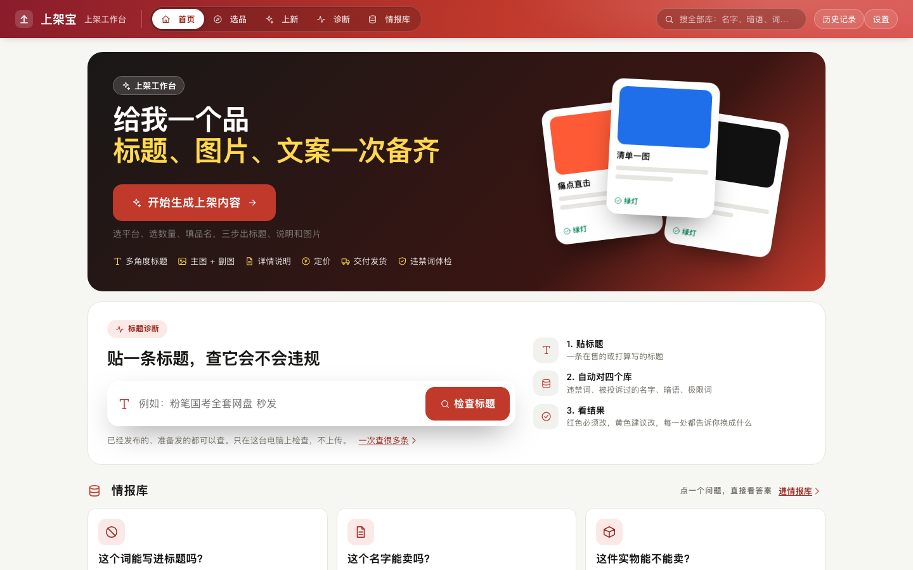

## 先知道三件事

- 你输入的标题、商品信息、导入的数据，只留在你自己的浏览器里，不上传。
- 不填密钥也能用：查标题、选品、情报库、模板稿和模板图都不需要联网。
- AI 写文案和 AI 出图要填你自己的密钥（DeepSeek 写文案，APIMart 出图）。在线版里没有内置任何密钥。密钥只存在你这台电脑的浏览器里，只发给你填的那两个接口。

## 使用流程

### 第一步：查标题能不能发

1. 打开首页，把想发的标题贴进输入框，点诊断。多条标题一行一个。
2. 结果里红色是建议下架或不要这样写，黄色是要核对，绿色是没查出问题。
3. 每个被标出来的词，旁边写了它是什么问题（被投诉过的名字、违禁词、暗语、红线题材）和怎么改。
4. 下面会列出是谁在投诉这类东西，点开能看这家公司还盯着哪些名字。

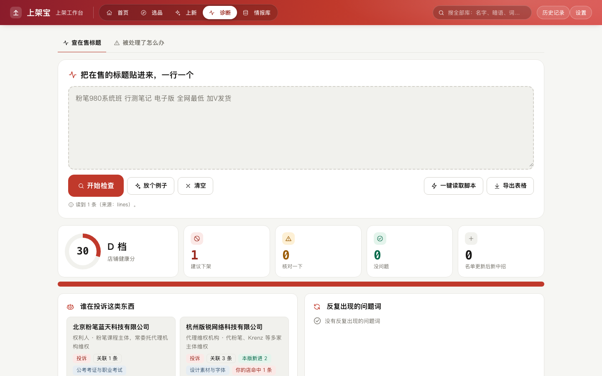

### 第二步：不知道卖什么，去「选品」

1. 点顶部的「选品」，看品类墙。虚拟商品和实物都有，一共 36 个品类。
2. 点一个品类进档案。档案写了新手能不能做、要准备什么、哪些名字不能用、哪些词会被拦、示范标题和反面案例。
3. 看中了就从档案里直接去「上新」。

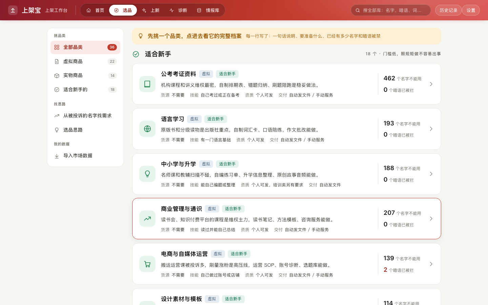

### 第三步：在「上新」里做上架内容

1. **卖什么**：填品名。下面的大框里想到什么写什么，比如里面有什么、想卖多少钱、成色和瑕疵。
2. **选类型**：虚拟商品还是实物，默认自动判断。
3. **参考图**（可选，实物必传）：
   - 虚拟商品：传几张你自己商品的内容截图，比如目录、内页、文件列表。
   - 实物：传你自己拍的这件商品的照片，最多 4 张。
   - 想参考同行的一条商品：看下面「参考同行的商品」。
4. **发到哪个平台**：闲鱼、小红书、淘宝、拼多多，标题字数和图片比例会跟着变。
5. **做几套**：1、3、5、10 套。一套就是一条能单独发布的商品。
6. 点「先出主图」或「一次出全套」。建议先出主图，满意了再出副图，省钱。

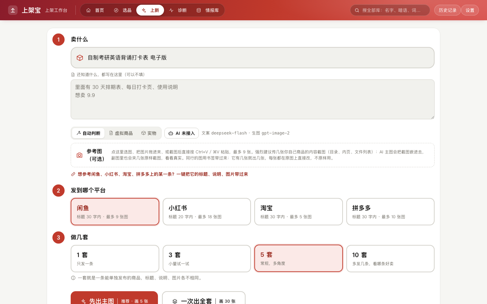

生成之后：

1. 最上面是体检结果。品名里有不能用的词，会自动换成合规写法，并告诉你换了什么。
2. 每套有不同的切入角度、标题和主图。点一张看整套。
3. 一套里面有：标题（带字数和红黄绿灯）、说明、三档定价、发货流程、拍下后的自动回复、发布前检查。
4. 标题和说明可以直接改，改完会重新检查。
5. 每块都有复制按钮，图片可以单张下载或整套下载。
6. 生成过的内容会自动存进右上角的「历史记录」，再打开不会重新花钱。

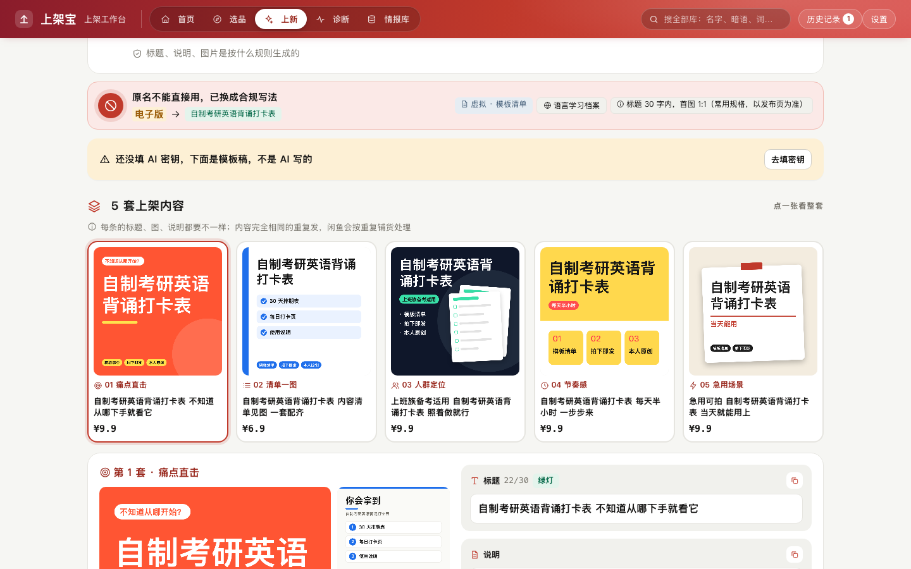

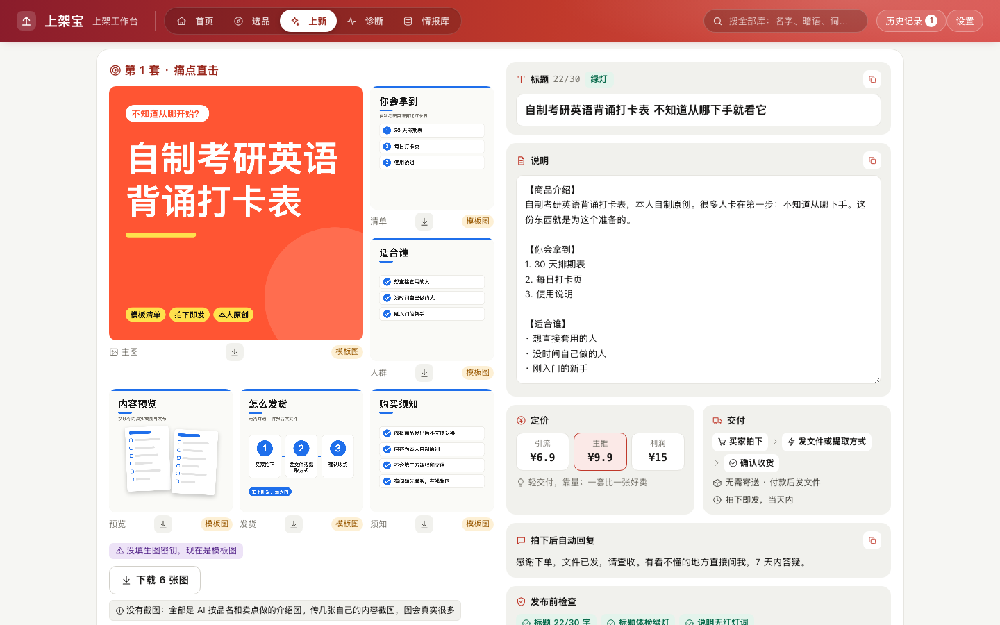

上面截图里的图是没填密钥时的模板图。填了密钥后，这些位置会换成 AI 出的图。

### 第四步：接上 AI（可选）

1. 点右上角「设置」，或上新页里的「AI 未接入」按钮。
2. 写文案：填 DeepSeek 的密钥（在 platform.deepseek.com 申请）。
3. 出图：填 APIMart 的密钥，模型默认是 `gpt-image-2`。
4. 保存。之后点生成，文案由 AI 按你选的套数写，图片由 AI 画。费用由你自己的账号承担，出几张图就算几张的钱。

AI 写出来的标题和说明会再过一遍违禁词、版权名单和暗语库，没通过的那一套会保留模板稿。图上只印检查过的那几行字。

### 参考同行的商品

1. 在上新页的参考图下面，展开「想参考闲鱼、小红书、淘宝、拼多多上的某一条？」，把「带到上架宝」按钮拖到浏览器的收藏夹栏。只用做一次。
2. 在你自己的浏览器里打开那条商品或笔记的详情页，点收藏夹里的「带到上架宝」，页面提示已复制。
3. 回到上新页，直接按 Ctrl+V（Mac 是 ⌘V）。标题填到「卖什么」，说明进信息框，图片进参考图。
4. 选平台、选套数、点生成。
   - 文案：照对方的结构整篇改写，不照抄句子，不带对方的店名、联系方式和价格。
   - 图片：对方有几张就出几张（不超过平台能发的张数，最多 9 张）。每张在对应的原图上改配色、字体和主图标题，去掉店名和水印。
5. 发布前逐张看一眼图。图上的字来自原图，程序没法提前检查。

这个按钮只在你点的那一刻读当前页面，不碰你的账号和登录信息。

### 第五步：店里在卖的，去「诊断」整批查

1. 点顶部的「诊断」，把在卖的标题全部贴进来，一行一个，点开始检查。
2. 结果按最该先处理的排序，给出店铺健康分、建议下架几条、要核对几条。
3. 已经被下架或被投诉了，切到「被处理了怎么办」，里面有处理步骤和申诉要点。

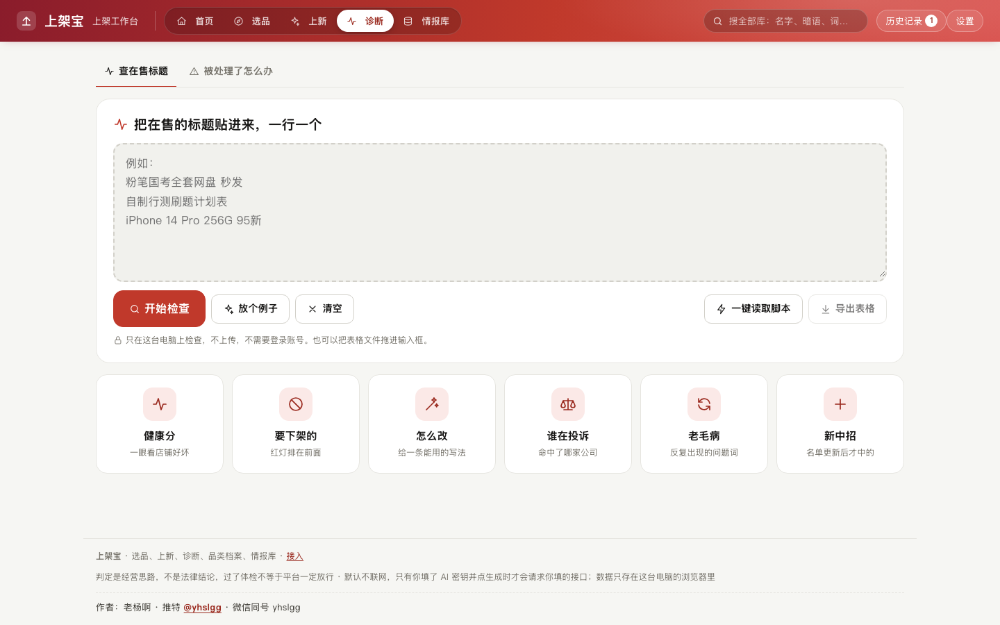

### 第六步：拿不准的，去「情报库」查

左边是板块，右边是内容，点任意一行看详情。

| 板块 | 用来查什么 |
|---|---|
| 违禁词 329 个 | 写了会被拦或限流的词 |
| 版权名单 4,489 条 | 哪些课、书、软件、品牌的名字被投诉过；点开看谁在盯、不能做什么、能做什么、可以换什么方向 |
| 红线题材 56 条 | 碰了会封号甚至违法的东西，只用来认 |
| 实物规则 | 这东西能不能卖、个人能不能发、违规扣多少分 |
| 暗语词典 755 条 | 别人标题里的怪词是什么意思，平台现在拦不拦 |
| 聊天话术 186 条、行话 86 个 | 买家卖家常说的话是什么意思 |
| 平台规则 | 四个平台的规则对照 |
| 谁在投诉 26 家 | 每家公司盯着哪些名字 |

顶部的搜索框可以一次搜全部库。

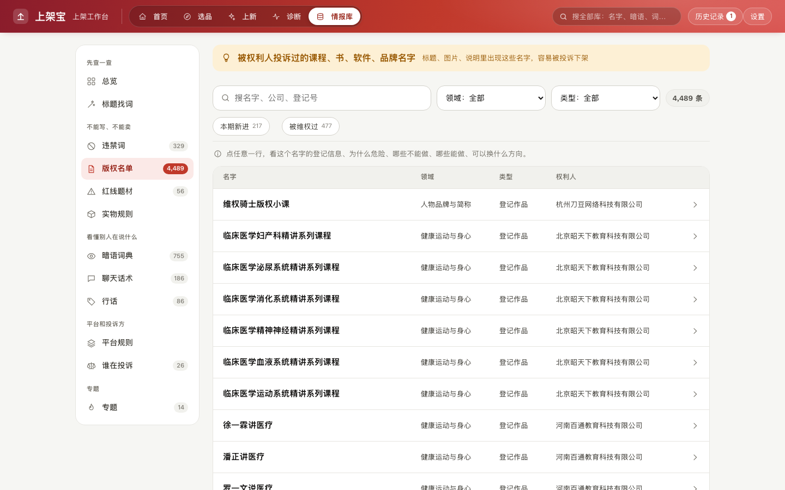

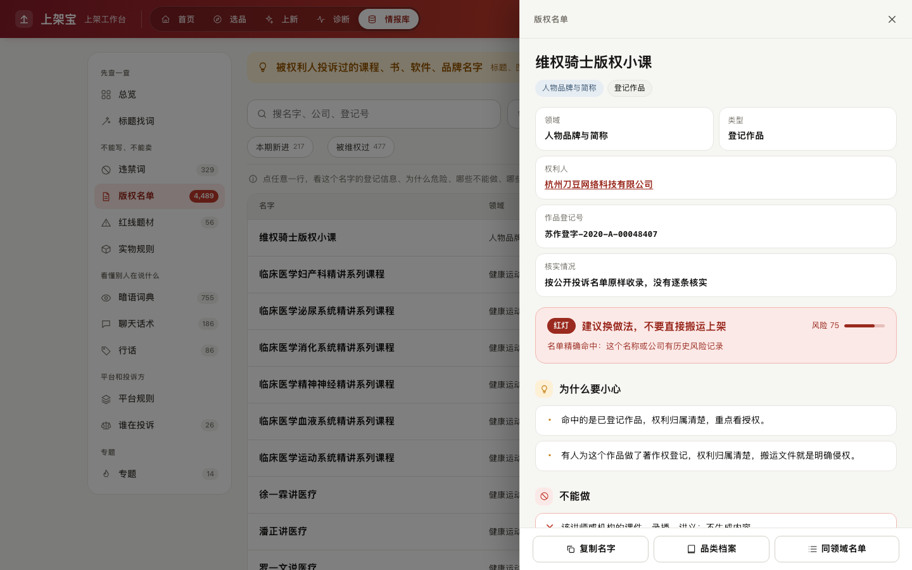

### 手机上也能看

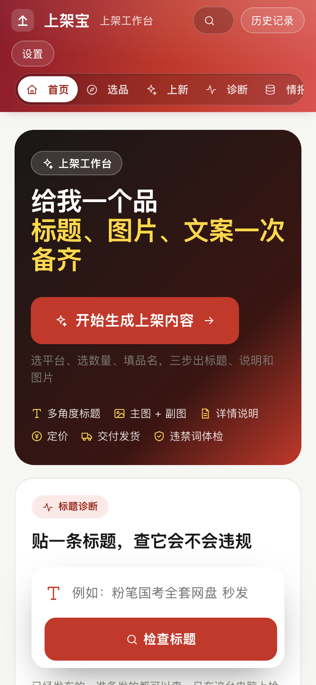 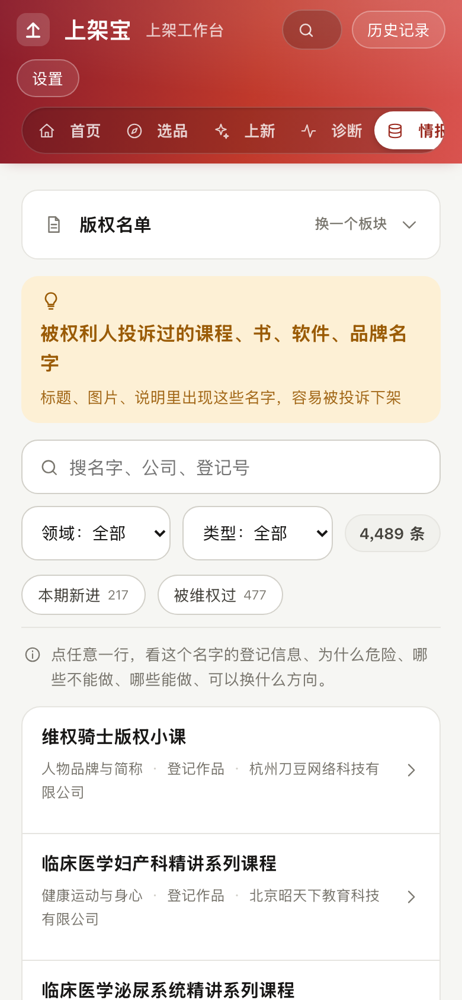

## 它不做什么

- 不保证平台一定放行。红黄绿判定是经营参考，不是法律结论。
- 不帮人卖红线上的东西，也不教人绕过平台审核。
- 不碰你的平台账号和登录信息。
- 参考同行不等于照搬：原样照搬会被判重复铺货或被投诉盗图。在原图上改出来的图离原图近，发布前要自己逐张看。

## 目录

```
index.html              成品网页，直接打开就能用
build/                  源码和构建脚本（python3 build/build.py）
skill/shangjiabao/      配套的 Claude 技能「上架宝」
书签脚本_带商品.js       「带到上架宝」书签的代码
docs/img/               上面这些网页截图
内测素材/               使用说明、功能介绍
```

只想用的话，有 `index.html` 就够了。自己构建还需要另一个项目提供版权名单和匹配引擎，那个项目不在这个仓库里，脚本里的路径也是作者本机的，要自己改。

## 数据来源

暗语词典和部分违禁词合并自多个开源仓库和网友共建的词库，详见 [数据来源与致谢](数据来源与致谢.md)。

## 作者

老杨啊 · 推特 [@yhslgg](https://x.com/yhslgg) · 微信同号 yhslgg
