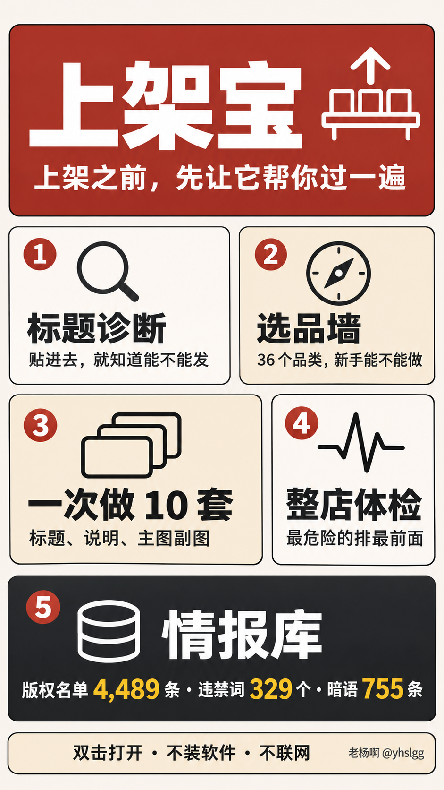

# 上架宝

上架之前，先让它帮你过一遍。

上架宝是给闲鱼、小红书、淘宝、拼多多卖家用的上架工作台。它是一个 HTML 文件，双击就能打开，不用安装、不用注册、不用联网。



## 怎么用

1. 点页面右上角的 **Code → Download ZIP**，解压。
2. 双击里面的 `index.html`，用浏览器打开。
3. 从首页开始：把你想发的标题贴进去，点诊断。

手机上也能看。你输入的内容只留在自己的浏览器里，不上传。

## 能做什么

| 页面 | 一句话 | 里面有什么 |
|---|---|---|
| 首页 · 标题诊断 | 标题贴进去，告诉你能不能发 | 同时对版权名单、违禁词、暗语、红线题材四个库，标红标黄，旁边写怎么改 |
| 选品 | 不知道卖什么，先看这面墙 | 36 个品类（虚拟和实物都有），每个品类 12 段档案：新手能不能做、要准备什么、哪些名字不能用、哪些词被拦 |
| 上新 | 一个品，一次做 1 到 10 套 | 每套的标题、说明、主图、副图都不一样，附定价、发货流程、自动回复和发布前检查 |
| 诊断 | 店里在卖的，整批查一遍 | 最危险的排最前面；被下架、被投诉后的处理步骤和申诉要点 |
| 情报库 | 能查的都在这 | 见下面的清单 |

情报库里有：

- **版权名单 4,489 条**：哪些课、书、软件、品牌的名字被投诉过。点开一条能看到谁在盯、不能做什么、能做什么、可以换什么方向。
- **违禁词 329 个**：写了会被拦或限流的词。
- **红线题材 56 条**：碰了会封号甚至违法的东西，只用来认。
- **暗语词典 755 条**：别人标题里的怪词是什么意思，平台现在拦不拦。
- **聊天话术 186 条、行话 86 个**。
- **谁在投诉**：26 家公司，各自盯着哪些名字。
- **实物规则**：这东西能不能卖、个人能不能发、违规扣多少分。
- **各平台规则对照**。

## 上新页的三种做法

- **只填品名**：按品名和你写的卖点出文案和介绍图。
- **传自己的截图**（虚拟商品）：AI 主图会把你的真实截图嵌进去，副图里夹几张原样截图。
- **参考同行的一条商品**：把「带到上架宝」按钮拖到收藏夹，在商品或笔记的详情页点一下，回来粘贴，标题、说明、图片就带过来了。文案会整篇改写。图片是对方有几张就出几张（不超过平台能发的张数），每张在对应的原图上改配色、字体和主图标题，去掉店名和水印。
- **实物商品**：只用你自己拍的照片，AI 只换场景和光线，不改商品外观，不修掉瑕疵。

出图和 AI 写文案需要你自己的密钥：在页面的 AI 设置里填 DeepSeek（写文案）和 APIMart（GPT Image 出图）。填了密钥、点了生成才会联网，密钥只存在本机浏览器里。不填也能用，标题、说明、图片由本地模板生成。

## 它不做什么

- 不保证平台一定放行。红黄绿判定是经营参考，不是法律结论。
- 不帮人卖红线上的东西，也不教人绕过平台审核。
- 不碰你的平台账号和登录信息。
- 参考同行不等于照搬：原样照搬会被判重复铺货或被投诉盗图。在原图上改出来的图离原图近，图上的字程序也没法提前检查，发布前要自己逐张看。

## 目录

```
index.html              成品网页，直接打开就能用
build/                  源码：template.html、styles.css、app.js、v3–v7.js、数据种子 seed*.py
build/build.py          构建：python3 build/build.py
build/pack.py           打包：python3 build/pack.py，产出 dist/ 下的压缩包
build/sources/          暗语和违禁词的原始数据副本
skill/shangjiabao/      配套的 Claude 技能「上架宝」：打开网页、整理书签带回来的商品
书签脚本_带商品.js       「带到上架宝」书签的代码
内测素材/               使用说明、功能介绍、介绍图
```

只想用的话，有 `index.html` 就够了。自己构建需要另一个项目（闲鱼版权雷达）提供版权名单和匹配引擎，那个项目不在这个仓库里；`build/build.py` 和几个截图脚本里写的是作者本机的路径，要自己改。

## 数据来源

暗语词典和违禁词合并自下面这些公开来源，感谢各位作者和投稿的网友。

| 来源 | 作者 / 网站 | 许可 |
|---|---|---|
| awesome-chinese-secondhand-slang | GitHub `Domainsun` | MIT |
| xianyu-slang-translator | GitHub `xianfanhuang` | MIT |
| xianyu-heihua | GitHub `ImAi10086` | MIT |
| xiaohongshu-prohibited-words | GitHub `bonniegeng-max` | MIT |
| xiaohongshu-prohibited-words | GitHub `wanglin1111111` | MIT |
| xianyu-slang-helper（闲鱼词典插件） | GitHub `memos-im` | 仓库里没有 LICENSE 文件 |
| xhs-compliance | GitHub `sleeppig0314-collab` | 没有许可声明 |
| SearchSharp | search-sharp.com | 没有许可声明 |
| 闲鱼黑话词典 | xianyuheihua.com | 网友投稿，没有许可声明 |
| 暗语站 | anyu.luckhub.cc | 没有许可声明 |
| 闲鱼黑话工具页 | gaoqian2580.com | 没有许可声明 |

版权名单来自公开的投诉名单整理。平台规则依据《闲鱼社区信息发布规范》（2023-06-26）和《闲鱼社区管理规范（试行）》（2023-06-01）。其余的违禁词和品类档案是人工整理。

标着「没有许可声明」的来源，这里只做了合并和署名。如果你是其中某个来源的作者，不希望数据出现在这里，请联系我，我会移除。

## 作者

老杨啊 · 推特 [@yhslgg](https://x.com/yhslgg) · 微信同号 yhslgg
